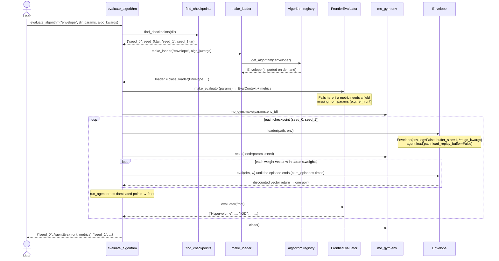

# `morl_reliable.evaluate`

Metrics for Pareto front approximations, and the post-training evaluation
pipeline that builds those fronts from saved agents.

- `morl_reliable.evaluate` (this package) scores a front: given the points an
  agent reaches, it computes Hypervolume, IGD, Expected Utility, and so on.
- `morl_reliable.evaluate_algorithm` builds the fronts: it finds the saved
  checkpoints of an algorithm, rebuilds each agent, runs its greedy policy for
  a fixed set of preference weights, and scores the resulting front with this
  package.

Every agent is evaluated with the same protocol (`EvalParams`), so the metrics
of different algorithms and seeds can be compared.

## Quick start

Train and save as usual, one checkpoint per seed:

```python
import mo_gymnasium as mo_gym
from morl_baselines.multi_policy.envelope.envelope import Envelope

agent = Envelope(mo_gym.make("deep-sea-treasure-v0"), net_arch=[256, 256], seed=0)
agent.train(total_timesteps=100_000)
agent.save(save_replay_buffer=False, save_dir="weights/envelope", filename="seed_0")
```

Then evaluate every checkpoint in the directory by passing the algorithm's
name, its constructor arguments and the evaluation protocol:

```python
import mo_gymnasium as mo_gym
from morl_baselines.common.weights import equally_spaced_weights
from morl_reliable import EvalParams, evaluate_algorithm

env_id = "deep-sea-treasure-v0"
params = EvalParams(
    env_id=env_id,
    ref_point=[0.0, -25.0],
    weights=equally_spaced_weights(2, n=100),
    ref_front=mo_gym.make(env_id).unwrapped.pareto_front(gamma=0.99),
    gamma=0.99,
)

results = evaluate_algorithm("envelope", "weights/envelope", params, algo_kwargs={"net_arch": [256, 256]})
results["seed_0"].front    # non-dominated points, shape (n_points, n_objectives)
results["seed_0"].metrics  # {"Hypervolume": ..., "Expected Utility": ..., ...}
```

`algo_kwargs` must match the training run wherever it changes the networks
(e.g. `net_arch`). Training-only arguments such as `buffer_size` can be left
out: built-in algorithms are rebuilt without a replay buffer.

## How it works

Sequence for `evaluate_algorithm("envelope", "weights/envelope", params, algo_kwargs)`
with two checkpoints:



The steps, in order:

1. **Find the checkpoints** (`find_checkpoints`). By default these are the
   `*.tar` files (PyTorch algorithms) or the finished Orbax directories (JAX
   algorithms) directly in `agents_dir`. Each one is named by its path
   without `.tar`, e.g. `seed_0`. Hidden paths, unfinished Orbax checkpoints
   and duplicate symlinks are skipped. Pass `pattern="*.pt"` for other
   formats.
2. **Build a loader** (`make_loader`). The algorithm can be given as a name
   (`"envelope"`), an `Algorithm` member, a class, or a ready-made `Loader`
   (`(path, env) -> agent`). Names and classes go through `class_loader`,
   which builds `cls(env, log=False, **algo_kwargs)` and calls
   `agent.load(path)`.
3. **Prepare the metrics** (`make_evaluator`). An `EvalContext` is built from
   `params`, and every requested metric is checked against it before any agent
   is run.
4. **Build each front** (`run_agent`). For each weight vector, the greedy
   policy runs `num_episodes` episodes; the average (discounted) vector return
   is one point. Dominated points are removed.
5. **Score each front** (`FrontierEvaluator`).

## Built-in algorithms

The names match `morl_baselines.common.experiments.ALGOS`, so a run launched
with `--algo X` is evaluated with the same `X`.

| Name                    | Class                                  | Checkpoint      |
|-------------------------|----------------------------------------|-----------------|
| `envelope`              | `Envelope`                             | `.tar` file     |
| `gpi_pd_discrete`       | `GPIPD`                                | `.tar` file     |
| `gpi_ls_discrete`       | `GPILS`                                | `.tar` file     |
| `gpi_pd_continuous`     | `GPIPDContinuousAction`                | `.tar` file     |
| `gpi_ls_continuous`     | `GPILSContinuousAction`                | `.tar` file     |
| `capql`                 | `CAPQL`                                | `.tar` file     |
| `gpi_ls_discrete_jax`   | `GPILS` (JAX)                          | Orbax directory |
| `gpi_ls_continuous_jax` | `GPILSContinuousAction` (JAX)          | Orbax directory |

Only weight-conditioned algorithms are listed, since the front is built by
querying `agent.eval(obs, w)`.

## Built-in metrics

`DEFAULT_METRICS` computes all of them. A metric whose required fields are
missing from `EvalParams` raises an error, or is skipped with a warning when
`on_missing=OnMissingBehavior.WARN`.

| Name (`MetricName`)                    | Needs                     |
|----------------------------------------|---------------------------|
| `Hypervolume` (`HV`)                   | `ref_point`               |
| `Inverted Generation Distance` (`IGD`) | `ref_front`               |
| `Expected Utility` (`EUM`)             | `weights`                 |
| `Maximum Utility Loss` (`MUL`)         | `ref_front`, `weights`    |
| `Sparsity` (`SPARSITY`)                | —                         |
| `Cardinality` (`CARD`)                 | —                         |

For an environment without a known front, pass `ref_front=None` and either
`on_missing=OnMissingBehavior.WARN` or `metrics=[MetricName.HV, MetricName.EUM, ...]`.

## Extending

### Your own algorithm

Register the class once, then evaluate it by name like a built-in:

```python
from morl_reliable import register_algorithm

@register_algorithm("my_algo")
class MyAlgo(MOAgent, MOPolicy):
    ...

results = evaluate_algorithm("my_algo", "weights/my_algo", params, algo_kwargs={...})
```

The class must be built with `cls(env, **kwargs)` and accept `log=False`,
restore a checkpoint with `agent.load(path, ...)`, return the greedy action
with `agent.eval(obs, w)`, and have a `gamma` attribute unless
`EvalParams.gamma` is set. If it saves something other than `.tar` files,
pass `pattern=`. Agents that cannot be rebuilt this way can be evaluated with
a custom loader: `evaluate_algorithm(my_loader, dir, params)`.

### Your own metric

```python
from morl_reliable.evaluate import register_metric

@register_metric("Best First Objective", requires={"ref_point"})
def best_first_objective(front, ctx):
    return float(front[:, 0].max() - ctx.ref_point[0])

params = EvalParams(..., metrics=["Hypervolume", "Best First Objective"])
```

`requires` lists the `EvalContext` fields the metric reads (`ref_point`,
`weights`, `ref_front`, `utility`).

### Scoring a front directly

The metrics can be used without any agent:

```python
import numpy as np
from morl_reliable.evaluate import EvalContext, FrontierEvaluator

ctx = EvalContext(
    ref_point=np.array([0.0, 0.0]),
    weights=np.array([[1.0, 0.0], [0.5, 0.5], [0.0, 1.0]]),
    ref_front=np.array([[10.0, 1.0], [6.0, 5.0], [1.0, 9.0]]),
)
FrontierEvaluator(ctx)(np.array([[9.0, 1.0], [5.0, 5.0]]))
```
